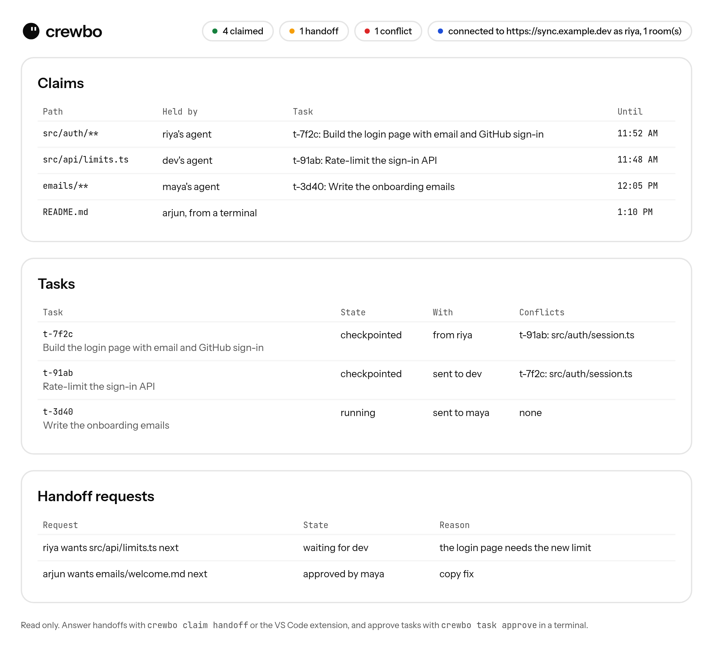
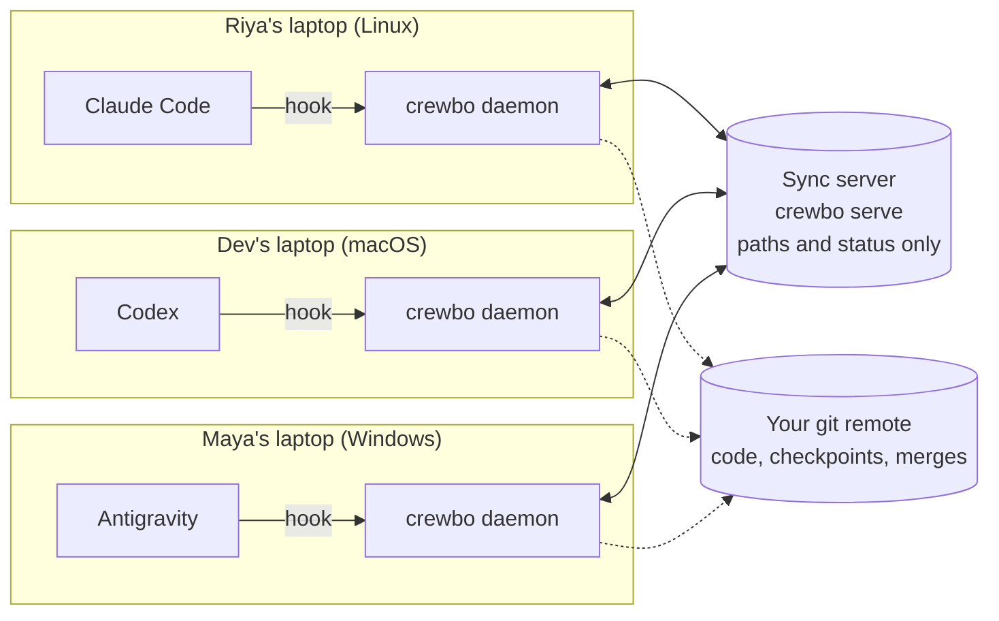

<p align="center">
  <picture>
    <source media="(prefers-color-scheme: dark)" srcset="docs/brand/assets/svg/logo/lockup-dark.svg">
    
  </picture>
</p>

<h3 align="center">Every agent, one crew.</h3>

<p align="center">
  Run every teammate's AI coding agent on the same repository, at the same time, without collisions.
</p>

<p align="center">
  <a href="docs/user/getting-started.md"><strong>Getting started</strong></a> ·
  <a href="docs/user/troubleshooting.md">Troubleshooting</a> ·
  <a href="docs/user/privacy.md">Privacy</a> ·
  <a href="docs/architecture/overview.md">Architecture</a> ·
  <a href="CONTRIBUTING.md">Contributing</a>
</p>

<p align="center">
  
  
  
  
</p>

---

In a team project or a hackathon, usually one person drives the AI agent while everyone else waits, or every agent edits the same files and the team finds out at merge time. Crewbo lets each teammate run their own agent (Claude Code, Codex or Antigravity), on their own machine and operating system, on the same repository. Every agent knows which files the others are working on, is stopped before it edits one of them, and conflicts between branches show up before anyone merges.

<p align="center">
  
  <br><sub>The local dashboard (<code>crewbo dashboard</code>), with example data.</sub>
</p>

## Features

**Claims that agents respect.** A file or glob is claimed for the agent working on it. Every agent's hook asks Crewbo before it edits a file or runs a shell command that writes one, and an edit to a teammate's file is refused with a message naming the file and the person. Claims are leases, so a crashed agent cannot hold a file for more than a few minutes.

**Hand-offs instead of fights.** Need a file someone holds? `crewbo claim request` asks them; they hand it off or say not yet, and the room lead can step in with a reason. Every step is logged for the room.

**A branch for every task.** Each piece of work is a task on its own branch and worktree. Crewbo checkpoints it when your agent finishes a reply and pushes the checkpoint to your remote, so the team's work is always visible.

**Conflict warnings before merge.** Crewbo runs `git merge-tree` on every pair of task checkpoints, across machines, and warns both people when their checkpoints conflict. `crewbo task merge` merges only through that check.

**Tasks from the lead, approved by you.** A room lead can send a signed task for a teammate's agent to run. Nothing runs until the teammate has read the whole task and typed `yes` in a terminal.

**See the whole room.** A view in VS Code, a local dashboard and the CLI. `crewbo doctor` checks your setup and tells you how to fix it.

**Your code stays yours.** File contents never leave your machine; code moves only through your own git remote. The sync server shares paths, task text and status, and you can run it yourself. No telemetry.

## How it works



1. A small **daemon** runs on each laptop. Each agent's **hooks** ask it before every edit, and it answers from its own copy of the room's claims, so an agent never waits on the network.
2. The daemons share claims, tasks and warnings through a **sync server** over WebSocket. One teammate runs it, or you host it; it never sees file contents.
3. **Checkpoints and merges** go through your own git remote, with your own credentials.

The design and its decisions: [architecture](docs/architecture/overview.md) and [decision records](docs/adr/).

## Supported agents and editors

| Agent | Claims enforced | Context and MCP tools | Runs tasks from the lead |
| --- | --- | --- | --- |
| Claude Code | Yes | Yes | Yes |
| Codex | Yes | Yes | Yes (not on Windows yet) |
| Antigravity | Yes | Yes | Not yet |

The editor extension is built for VS Code and tested there; it is meant to work in VS Code-based editors such as Cursor, Windsurf and VSCodium too. The CLI and dashboard work everywhere.

## Quick start

There is no release yet: build from source with Go (the version in `go.mod`), git 2.38 or later and [Task](https://taskfile.dev).

```sh
git clone https://github.com/crewbo/crewbo && cd crewbo
task build                                   # creates bin/crewbo
```

One teammate runs the sync server where everyone can reach it ([how](docs/user/getting-started.md#running-the-sync-server)):

```sh
crewbo serve
```

Then everyone, inside their clone of the team's repository:

```sh
crewbo daemon                                # keep this running
crewbo login --server https://your-server    # sign in with GitHub
crewbo room create                           # the lead, once; then: crewbo room invite
crewbo room join CODE                        # everyone else
crewbo hooks install                         # Claude Code, Codex and Antigravity; your own hooks are kept
crewbo doctor                                # checks the setup and prints a fix for anything missing
```

The full walkthrough, including Codex's hook trust step and the editor extension, is in [Getting started](docs/user/getting-started.md).

## Commands at a glance

| Command | What it does |
| --- | --- |
| `crewbo claim add PATH` / `list` / `release ID` | Claim files for yourself, see claims, release them |
| `crewbo claim request PATH` | Ask the holder of a file to hand it over; `crewbo claim handoff ID approve` answers |
| `crewbo task start "TEXT"` | Start a task of your own on a new branch and worktree |
| `crewbo task merge ID` | Merge a checkpointed task into main, through the conflict check |
| `crewbo task create --to LOGIN "TEXT"` | As the lead, send a signed task to a teammate's agent |
| `crewbo task approve ID` | Read a task sent to you and approve it, in a terminal |
| `crewbo dashboard` | Open the local, read-only dashboard |
| `crewbo doctor` | Check this computer's setup |
| `crewbo report` | Print counts of your Crewbo use for a survey; sends nothing |

`crewbo help` lists everything.

## Status and roadmap

Crewbo is in **preview** (v0.x): it works end to end on Linux, the main flows have run across Linux and macOS, and Windows is partly tested. Expect rough edges and breaking changes until v1.

| Version | Focus |
| --- | --- |
| v1 (now) | Claude Code, Codex and Antigravity; claims, hand-offs, tasks, conflict warnings, merging; VS Code extension and dashboard; self-hosted sync server; tested with real hackathon teams |
| v2 | More agents (Cursor, Gemini CLI, Copilot CLI), Antigravity tasks, symbol-level claims, signed installers, a free hosted sync server |
| v3 | A paid hosted plan for teams, policies and reports, larger rooms |

The full plan is in the [product requirements](docs/product/PRD.md).

## Contributing

Issues and pull requests are welcome. Read [CONTRIBUTING.md](CONTRIBUTING.md) first: contributors sign a short [contributor licence agreement](docs/legal/CLA.md) once, through a bot on their first pull request. Please follow the [code of conduct](CODE_OF_CONDUCT.md), and report security problems privately as described in [SECURITY.md](SECURITY.md).

## License

- The sync server, `internal/server` (`crewbo serve`), is licensed under the [GNU Affero General Public License v3.0](internal/server/LICENSE) (ADR 0011).
- Everything else, including the daemon, hooks, CLI, protocol, VS Code extension and dashboard, is licensed under the [Apache License 2.0](LICENSE).
- `crewbo` is a single binary that includes the sync server, so each released binary is covered by the AGPL-3.0 as a whole. The Apache-2.0 parts stay reusable on their own.

See [NOTICE](NOTICE).
