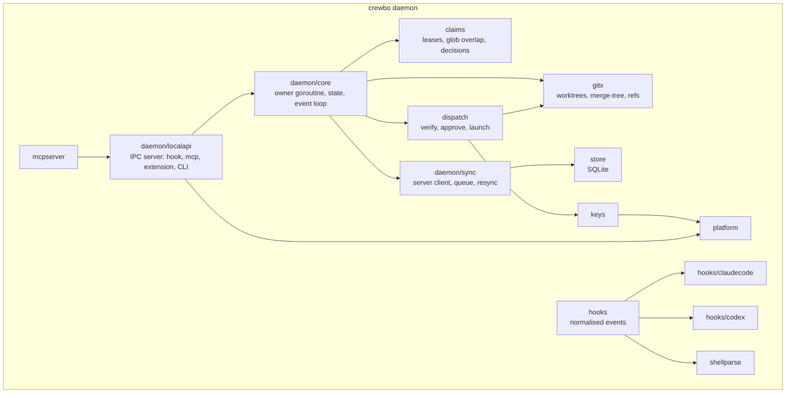
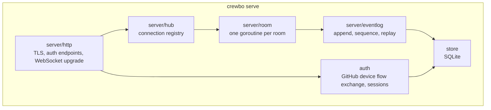

# Components (C4 level 3)

Package names match the repository layout in `CLAUDE.md`. Arrows mean "calls".

## Daemon

| Package | Responsibility | Key interface |
| --- | --- | --- |
| `internal/claims` | Pure logic: claim set, lease expiry, glob overlap, `Decide(edit) -> Allow / Deny(reason)`. No I/O, no clock calls (time passed in). | `type Set`, `func (s *Set) Decide(Edit, time.Time) Decision` |
| `internal/hooks` | Normalised event model (`session_start`, `prompt`, `pre_edit`, `post_edit`, `stop`) and the hook process main loop. | `type Event`, `type Adapter interface { Decode([]byte) (Event, error); Encode(Response) ([]byte, int) }` |
| `internal/hooks/claudecode` | Claude Code payload decode and response encode. | `Adapter` |
| `internal/hooks/codex` | Codex payload decode, `apply_patch` header parsing, response encode within Codex's strict schema. | `Adapter` |
| `internal/shellparse` | Extract write targets from a shell command (POSIX via `mvdan.cc/sh`, PowerShell token check). | `func WriteTargets(cmd string, dialect Dialect, cwd string) ([]Target, Confidence)` |
| `internal/gitx` | Run system git: version check, worktree add and remove, `merge-tree --write-tree`, push and fetch of refs. | `type Git interface` |
| `internal/dispatch` | Verify signed tasks, hold for approval, prepare worktree, launch the agent CLI headless, observe exit. | `type Launcher interface` per vendor |
| `internal/keys` | Ed25519 key generation, signing, keychain with file fallback. | `type Store interface { Load(); Save() }` |
| `internal/daemon` | Lifecycle, owner goroutine, local API, sync client, offline queue. | |
| `internal/mcpserver` | MCP tools as Go structs, calling the local API. | |
| `internal/platform` | IPC transport, service install, data dirs, process spawning. | `Listener`, `Dialer`, `Paths` |
| `internal/store` | SQLite schema and migrations for daemon and server. | |

Local API (#16): newline-delimited JSON over the daemon socket. The first line of every connection carries a random token that the daemon writes to `daemon.token` (owner-only) in the runtime directory at each start; connections without it within 2 s are dropped. Methods so far: `event` (register the agent session, renew its leases), `decide` (does the same, then checks claims, so an edit costs one round trip) and `status` (`internal/daemon/api.go`, #43).

Concurrency rule: one owner goroutine holds daemon state. API handlers send requests over a channel and wait for a reply with a context deadline. This keeps the claim set free of locks and easy to simulate (`test/sim`).

### Hook process

The hook process is short-lived and must not load daemon state. Flow: read stdin (size-capped), decode with the agent adapter, normalise, call the daemon over IPC with a deadline (target 300 ms, an UNVERIFIED budget to be measured in Phase 0), encode the response. Any error, timeout or daemon absence yields "allow" plus a visible warning.

## Sync server

| Package | Responsibility |
| --- | --- |
| `server/http` | HTTP listener, `/v1/auth/*`, `/v1/ws` upgrade, health check. |
| `auth` | Exchange a GitHub token for a Crewbo session, register device public keys. |
| `server/hub` | Track connections, route frames to rooms. |
| `server/room` | Room state machine: membership, presence, current claims projection, lead role. Validates every request against the room's state. |
| `server/eventlog` | Assigns per-room sequence numbers, persists events, serves replay from a sequence number. |

The server never verifies task contents beyond the signature envelope and size limits; signature verification that gates execution happens on the receiving daemon.
