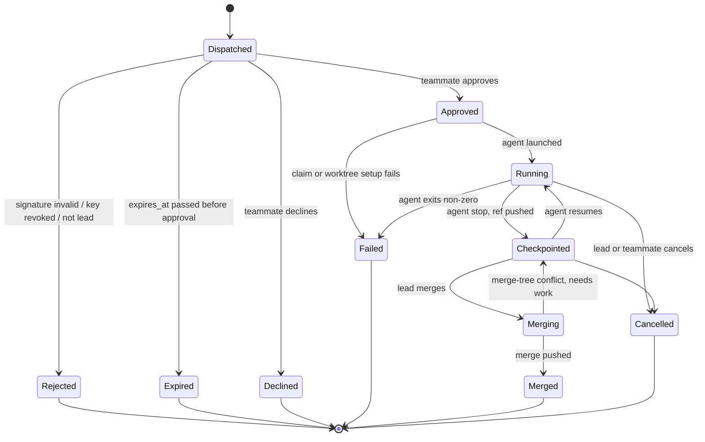
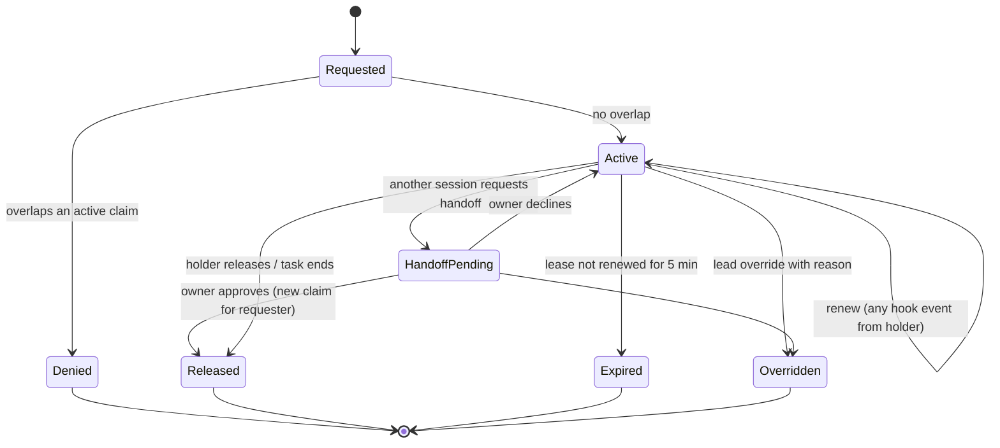

# Data model

Draft for Gate A. Field types are logical; storage types are decided with the SQLite schema in milestone M1.

## Entities

| Entity | Key fields | Invariants |
| --- | --- | --- |
| Org | `id`, `name` | v1 has one implicit org per server. Placeholder for v3 teams. |
| Room | `id`, `name`, `repo_remote_url`, `lead_member_id`, `created_at`, `next_seq` | At most 10 members (PRD NFR). Exactly one lead. `next_seq` only increases. |
| Member | `id`, `room_id`, `github_user_id`, `github_login`, `role`, `joined_at`, `left_at` | One active membership per GitHub user per room. |
| Role | `lead` or `member` | Lead is the room creator until an explicit `LeadTransfer` event. |
| Device | `id`, `member_github_user_id`, `name`, `os`, `created_at`, `revoked_at` | A member may have several devices. |
| Key | `id` (fingerprint of the public key), `device_id`, `public_key` (Ed25519, 32 bytes), `created_at`, `revoked_at` | Private seed never leaves the device. Revoked keys are never accepted again. |
| Invite | `code_hash`, `room_id`, `created_by`, `expires_at`, `max_uses`, `uses` | Stored as a hash. Default expiry 24 h (decision log). |
| AgentSession | `id` (agent's own session or thread id), `member_id`, `device_id`, `vendor` (`claude_code` or `codex`), `worktree_path_hash`, `task_id` (optional), `started_at`, `last_seen_at`, `ended_at` | Worktree path is hashed before leaving the machine (paths outside the repo are not shared). |
| Task | `id` (UUIDv7), `room_id`, `author_member_id`, `author_key_id`, `assignee_member_id`, `text`, `owned_paths[]`, `base_commit`, `created_at`, `expires_at`, `signature`, `state`, `branch`, `checkpoint_ref` | Signature covers the exact serialized `TaskBody` bytes (see protocol.md). Text max 32 KiB. |
| Claim | `id`, `room_id`, `pattern` (repo-relative path or glob, `/` separators), `kind` (`file` or `glob`), `holder_session_id`, `holder_member_id`, `task_id` (optional), `state`, `lease_expires_at`, `created_at` | No two active claims in a room overlap unless one is a handoff in progress. |
| Lease | Embedded in Claim: `lease_expires_at`, `renewed_at` | Expiry decided by the server clock. Default 5 min. |
| Intent | `id`, `session_id`, `summary` (max 280 chars), `paths[]`, `updated_at` | Free text from the agent's prompt summary; shown to others, never enforced. |
| Event | `room_id`, `seq`, `type`, `actor_member_id`, `actor_device_id`, `payload`, `server_time` | Append-only. `(room_id, seq)` is unique and gap-free. |

## Path normalisation

Every path stored or compared is repository-relative, uses `/`, has no `.` or `..` segments, and is compared case-insensitively on every OS: claims cross machines, and a path that differs only in case is the same file on a default Windows or macOS checkout (implemented in `internal/claims`, #13). Absolute paths from agents (Claude sends backslash paths on Windows) are converted by the daemon before any comparison.

## Glob overlap

Globs use doublestar syntax (`**`, `*`, `?`, `[...]`). Two patterns overlap if some path could match both. v1 uses a conservative check: compare literal prefixes up to the first wildcard segment; if one prefix is a prefix of the other, treat as overlapping. This can report false conflicts but not miss real ones. Exact overlap is a v2 refinement.

## Task state machine

## Claim state machine

On wake from sleep, a daemon whose claims expired re-requests them; if another session took a path meanwhile, it warns the user instead.
