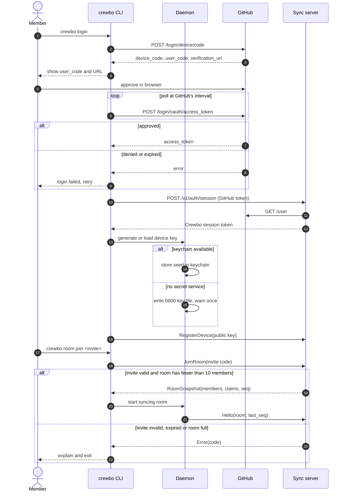
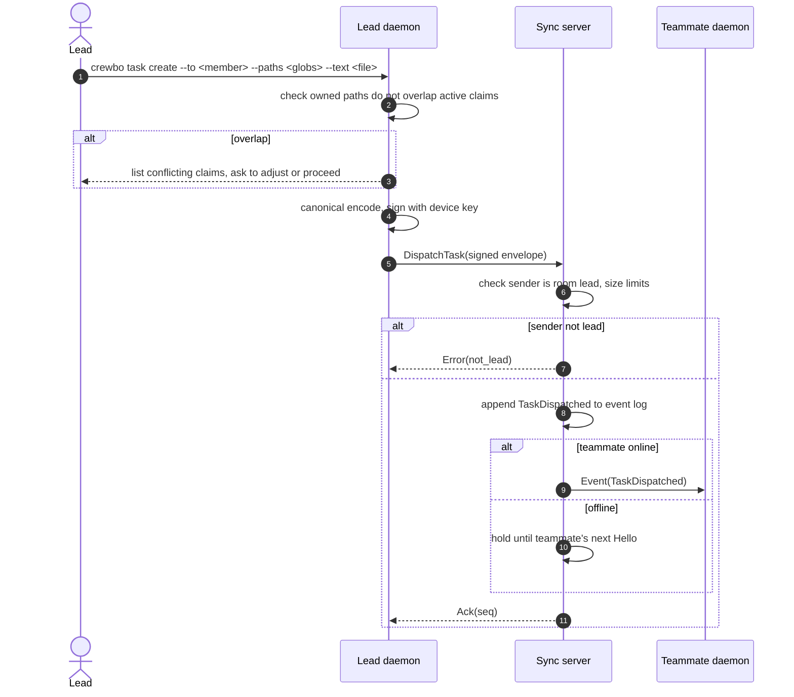
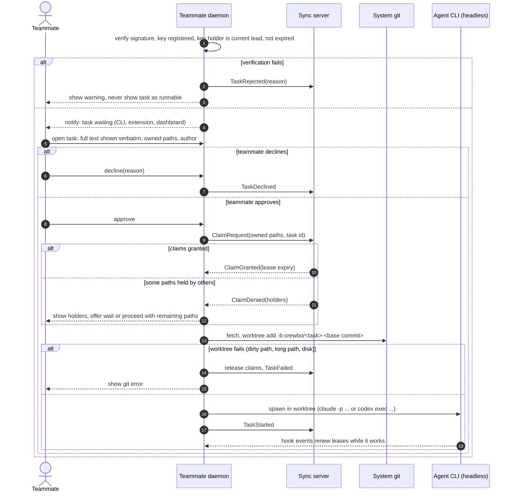
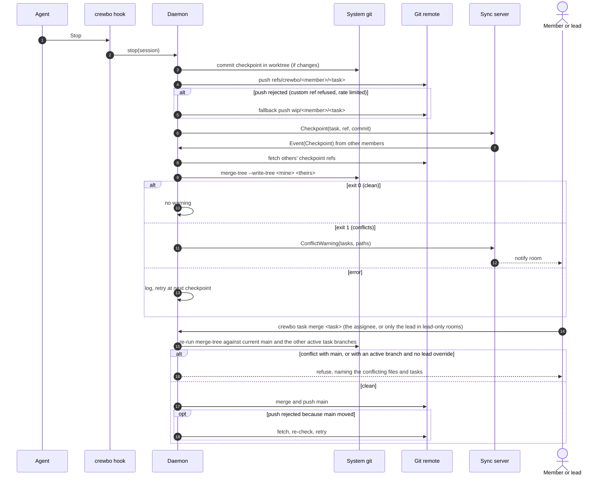

# v1 flows

One sequence diagram per PRD flow, including failure branches. Message names refer to [protocol.md](protocol.md).

## Flow 1: join a room

Presentation copy: [Lucid](https://lucid.app/lucidchart/3ffc1161-3058-43be-887c-666e09b4460a/view). Mermaid below is the source of truth.



## Flow 2: lead dispatches a signed task

Presentation copy: [Lucid](https://lucid.app/lucidchart/cafe99c3-9fe7-4f91-a20a-9f335b3af3ec/view). Mermaid below is the source of truth.



## Flow 3: teammate approves; agent claims and runs in a fresh worktree

Presentation copy: [Lucid](https://lucid.app/lucidchart/877460d5-202f-4d59-a91c-8de3023a5ebe/view). Mermaid below is the source of truth.



## Flow 4: edit to a claimed file is blocked and the owner notified

Presentation copy: [Lucid](https://lucid.app/lucidchart/fcb2aaf3-4205-4d8b-b76d-6bb68f91aa14/view). Mermaid below is the source of truth.

```mermaid
sequenceDiagram
  autonumber
  participant A as Agent B
  participant H as crewbo hook
  participant DB as Daemon B
  participant S as Sync server
  participant DA as Daemon A (holder)
  actor O as Owner (member A)

  A->>H: PreToolUse JSON on stdin
  H->>DB: Decide(pre_edit, paths) within deadline
  alt daemon unreachable or timeout
    H-->>A: allow + warning "Crewbo daemon not reachable, claims not enforced"
  else path free or held by this session
    DB-->>H: allow (renew own lease)
    H-->>A: exit 0, no decision
  else held by another session
    DB-->>H: deny(holder, task, lease expiry)
    H-->>A: deny, reason "src/auth.ts is claimed by A's agent for task 12. Options: wait, work on other files, or run crewbo claim request-handoff src/auth.ts"
    DB->>S: ConflictObserved(path, requester)
    S->>DA: Event(ConflictObserved)
    DA-->>O: notify (extension, CLI)
    opt agent or teammate requests handoff
      DB->>S: HandoffRequest(path, reason)
      S->>DA: Event(HandoffRequested)
      alt owner approves
        O->>DA: approve handoff
        DA->>S: ClaimRelease(path) then ClaimGrant to requester
      else owner declines or no answer within lease
        O->>DA: decline
        opt lead override
          Note over S: lead sends LeadOverride(path, reason); logged in event log
        end
      end
    end
  end
```

Shell edits follow the same path through `pre_shell`. After a shell command runs, `post_edit` compares hashes of claimed files; a change to a file claimed by someone else produces `ClaimViolation` (alert and record, no revert).

## Flow 5: cross-machine merge-tree warning before merge

Presentation copy: [Lucid](https://lucid.app/lucidchart/0c8b27cd-799d-469e-8c99-8d6c9dba55f9/view). Mermaid below is the source of truth.



Merging follows ADR 0014: by default the task's assignee merges their own work through this check, and the remote serialises merges; a lead-only room refuses merges from anyone but the lead. Self-started tasks (`crewbo task start`) go through the same flow.
