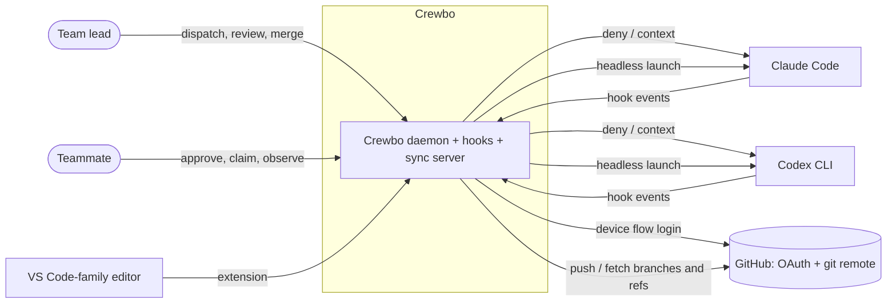
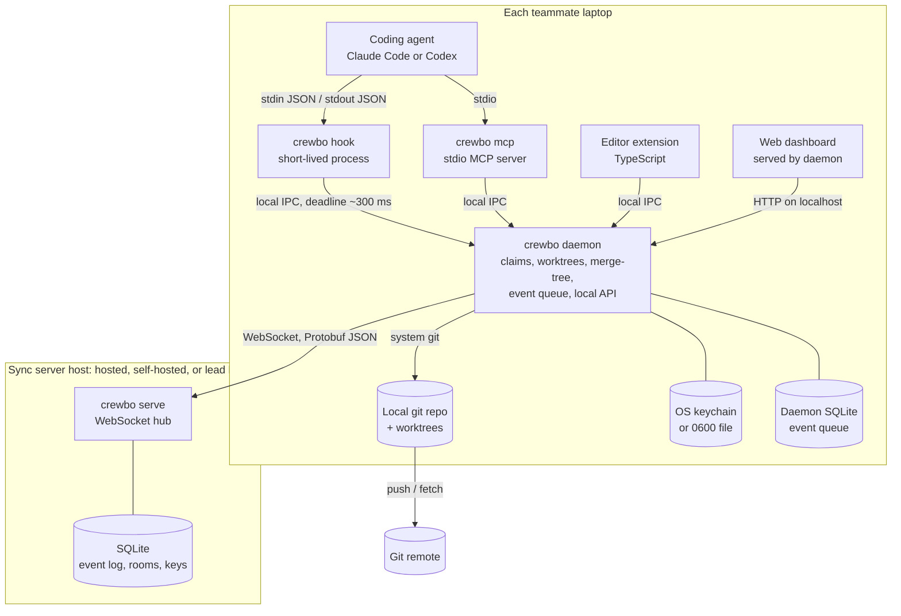

# Architecture overview

Status: draft for Gate A, 2026-10-11. Source of truth for product scope: [PRD](../product/PRD.md). Decisions: [ADRs](../adr/).

## Level 1: system context

Presentation copy: [Lucid](https://lucid.app/lucidchart/edbff025-4e98-4417-99fa-6327ce8b1f06/view). Mermaid below is the source of truth.

Crewbo sits between each teammate's coding agent and the team. It never hosts code: code moves only through the team's git remote. The sync server sees metadata only.

| Actor or system | Interaction |
| --- | --- |
| Team lead | Creates the room, dispatches signed tasks, reviews conflict warnings, merges through the merge queue. One lead per room. |
| Teammate | Joins with an invite, approves tasks after reading them verbatim, works with their own agent. |
| Claude Code, Codex CLI | Call `crewbo hook` through their native hook systems; are launched headless for dispatched tasks. |
| Editor | Shows claims, intents and conflict warnings through the extension. |
| GitHub | OAuth device flow identity; the git remote that carries all code. |

## Level 2: containers

Presentation copy: [Lucid](https://lucid.app/lucidchart/f964aecb-7153-4893-b402-cf9300435660/view). Mermaid below is the source of truth.

| Container | Process lifetime | Responsibility |
| --- | --- | --- |
| `crewbo hook` | One process per hook event | Decode agent payload, ask the daemon, print the agent's response. Fails open. |
| `crewbo daemon` | Long-running, one per user per machine | Claims and leases, intents, worktrees, merge-tree checks, merge queue (on the lead), headless agent launch, local API, offline queue. |
| `crewbo mcp` | Started by the agent over stdio | Read-only MCP tools backed by the daemon. |
| `crewbo serve` | Long-running | Rooms, membership, device keys, presence, the event log, store-and-forward of tasks. |
| Extension, dashboard | Editor or browser session | Display state, approve tasks, request handoffs. |

Local IPC is a Unix domain socket on every OS, including Windows (AF_UNIX, Windows 10 1803 or later), and every connection starts with a token from a user-only file (see [cross-platform.md](cross-platform.md)).

## What leaves a laptop

File paths, globs, task text, branch names, agent vendor, presence. Never file contents. No telemetry by default.

## Related documents

- [components.md](components.md): packages inside the daemon and server.
- [flows.md](flows.md): sequence diagrams for the five v1 flows.
- [data-model.md](data-model.md), [protocol.md](protocol.md), [hooks.md](hooks.md).
- [threat-model.md](threat-model.md), [failure-modes.md](failure-modes.md), [cross-platform.md](cross-platform.md).
