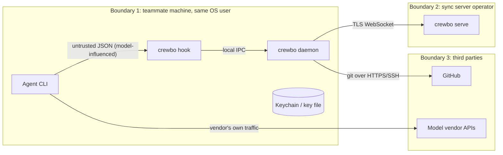

# Threat model

Method: STRIDE per component, draft for Gate A, 2026-10-11. Review again before the first public release.

## Assets

1. Source code and secrets on teammates' machines.
2. The ability to run an agent on a teammate's machine (via dispatch).
3. Device signing keys.
4. Room metadata: paths, task text, branch names, membership.
5. Integrity of claims (an attacker who can forge claims can block a team).

## Trust boundaries

- Inside boundary 1, Crewbo trusts processes of the same OS user. It does not defend against local malware running as that user.
- Hook input is model-influenced: tool inputs are written by an LLM that may have read injected content. Treat as untrusted.
- The server is semi-trusted: it relays and orders, but cannot forge tasks (signatures verified on the receiving device).

## STRIDE

### Hook process

| Threat | Example | Mitigation |
| --- | --- | --- |
| Tampering | Crafted path (`../`, mixed separators, case tricks, symlinks) bypasses a claim | Normalise to repo-relative form, resolve symlinks inside the repo, case-fold check on case-insensitive filesystems |
| Denial of service | Huge stdin payload | Cap stdin read (1 MiB) and fail open with a warning |
| Elevation | Shell command writes a claimed file without matching a known verb | Parser plus post-run hash check; documented residual risk |

### Daemon

| Threat | Example | Mitigation |
| --- | --- | --- |
| Spoofing | Another local user connects to the IPC socket | Unix socket in a user-only directory (0700 on Unix, a user-only ACL on Windows), and a token from a user-only file on every connection |
| Spoofing | Browser page on localhost calls the dashboard API | Dashboard binds to 127.0.0.1, requires a per-session token, checks `Origin` and `Host` (DNS rebinding) |
| Tampering | Malicious dispatched task text instructs the agent to exfiltrate secrets | Verbatim approval gate; fresh worktree; teammate's own non-bypass permission mode; text never interpreted by the daemon |
| Information disclosure | Logs contain task text or tokens | `slog` handlers never log task bodies, tokens or keys; redaction tests |
| Elevation | Launch with `bypassPermissions` or `danger-full-access` | Launcher allow-lists modes; tests assert flags |
| Tampering | A ref or branch name from a room event (for example `--upload-pack=...`) reaches git as an option | `gitx` rejects refs that are empty or start with `-`; paths follow `--`; git runs without a shell (#18) |
| Repudiation | Teammate denies approving a task | Approval event signed by the teammate's device key and logged |

### Dispatch path (prompt injection)

1. Lead (or an attacker with the lead's key) writes task text containing hostile instructions.
2. Server relays it; it cannot alter it without breaking the signature.
3. Teammate's daemon verifies the signature and the lead role, then shows the full text.
4. The teammate approves or declines. The residual risk is a teammate approving without reading.
5. The agent runs with the teammate's normal permissions in a fresh worktree. Repository files read by the agent remain an injection vector, the same as without Crewbo.

### Sync server

| Threat | Example | Mitigation |
| --- | --- | --- |
| Spoofing | Join a room without an invite | Invite codes are random (128 bits), hashed at rest, expiring, use-limited |
| Tampering | Server operator forges a task | Not possible without a lead device key; daemons verify |
| Tampering | Server operator forges or deletes claims or events | Possible. Impact: blocking or unblocking edits, not code execution. v2 option: sign claim events with device keys |
| Repudiation | Lead override without trace | Overrides require a reason and are logged |
| Information disclosure | Server breach exposes paths, task text, membership | Minimise data; document what is stored; self-hosting option; TLS required |
| Denial of service | Flood of connections or events | Per-device rate limits, frame size limits, room size cap 10 |
| Elevation | Member performs lead actions | Server checks role on every request; daemons also check the lead role before accepting tasks |

## Hook binary replacement

Codex trust covers the hook entry, not the executable (Phase 0, U-02), and Claude Code runs whatever binary the configured path points at. Anyone who can overwrite `crewbo` at its install path runs code as a trusted hook in every agent session. This is inside trust boundary 1 (same OS user), so it adds no new attacker, but the install directory must be writable only by the user, and package-manager installs must keep the binary outside world-writable paths.

## Key compromise

- Device key stolen: attacker can sign tasks as that device. If it is the lead's device, teammates still see the text and must approve. Response: `crewbo device revoke`, which writes a revocation event; daemons reject that key from then on. Runbook: `docs/runbooks/key-rotation.md` (to be written in M3).
- Server session token stolen: attacker can act as that member on the server (claims, intents) but cannot sign tasks. Tokens are short-lived and bound to a device key.

## Malicious teammate

A member can claim broad globs to block others, read all room metadata, and decline tasks. Mitigations: lead override with reason, glob breadth warning (claims over 200 matched files ask for confirmation), lead can remove members. A malicious lead can dispatch hostile tasks; the approval gate is the only defence, and this is documented to users.

## Compromised server

Can: read metadata, reorder or drop events, forge claims, deny service, replay old tasks (blocked by task expiry and seen-id tracking on daemons). Cannot: read code, forge tasks, run anything on a teammate's machine.

## Out of scope for v1

Local malware, a compromised agent CLI, a compromised GitHub account, model vendor data handling.
